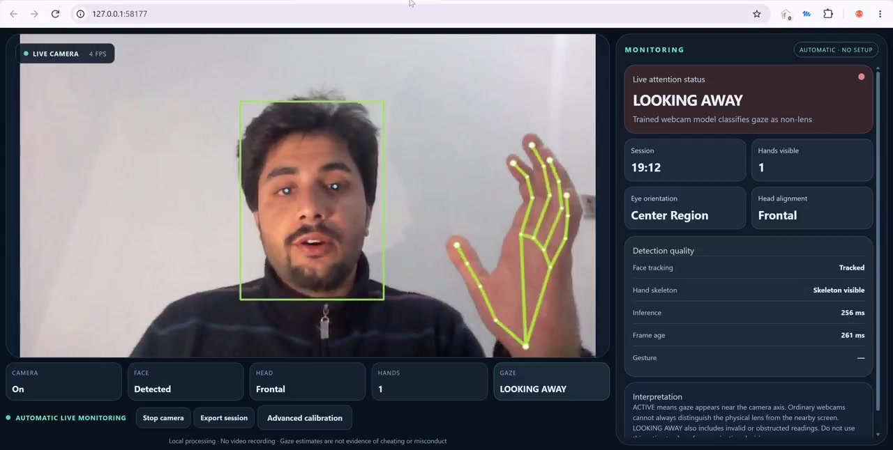
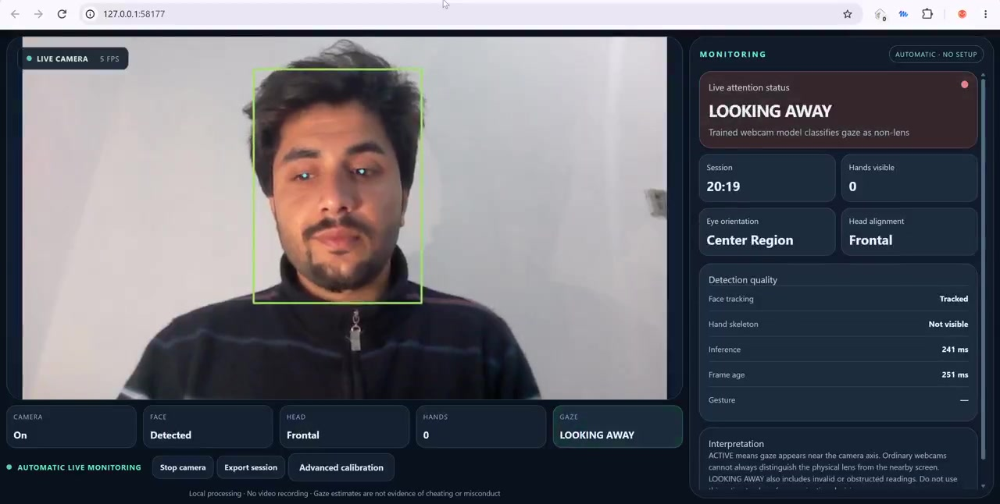

<div align="center">

# GazeGuard

### Real-Time Webcam Gaze & Attention Monitoring

**A privacy-conscious computer vision research project with live face and hand tracking, a local browser dashboard, and an optional trained gaze classifier.**


[**Live Demos**](#live-demonstrations) · [Features](#features) · [Quick Start](#quick-start) · [Training](#model-training) · [Project Structure](#project-architecture)

</div>

> [!IMPORTANT]
> **Research and demonstration software, not a validated cheating detector.** The displayed `ACTIVE` / `LOOKING AWAY` labels are webcam-derived estimates and do not prove lens fixation, genuine attention, screen reading, or misconduct. A standard laptop webcam can struggle to separate camera-lens gaze from nearby screen gaze. Neither the demo recordings nor the unit tests establish real-world accuracy.

## Live demonstrations

Two **real, separately playable GazeGuard screen recordings**, prepared for a professional GitHub presentation. Both preserve their original sequence and all visible dashboard results; they are not synthetic animations or performance benchmarks.

### 01 — Live hand landmark tracking

**Full original recording · 27.5 seconds · 1× playback speed**

[](assets/demo/GazeGuard_Hand_Tracking_Full.mp4)

**[▶ Watch full hand tracking video](assets/demo/GazeGuard_Hand_Tracking_Full.mp4)**

Demonstrates the live camera preview, visible hand recognition, and landmark connections drawn across the fingers and palm. This is the **complete 16:36:28 recording**, with no sections removed; only resolution/compression were optimized for GitHub.

### 02 — Live gaze and attention states

**Full original recording · 17.9 seconds · 1.5× playback speed**

[](assets/demo/GazeGuard_Gaze_Detection_1_5x.mp4)

**[▶ Watch gaze detection video (1.5×)](assets/demo/GazeGuard_Gaze_Detection_1_5x.mp4)**

Demonstrates real-time face tracking, displayed `ACTIVE` / `LOOKING AWAY` status changes, and gaze/head signals. This is the **complete 16:37:48 recording**, accelerated to **1.5×** for concise viewing; no segments were cut. Playback speed is an editorial choice, **not evidence of detector latency**.

> On GitHub, click a thumbnail or **Watch** link to open the corresponding MP4. The preview images and small compressed videos are version-controlled; private datasets and personal training recordings are not.

## Overview

GazeGuard is a local Python application that starts webcam analysis, presents live results through a browser dashboard, and estimates gaze alignment, head orientation, and hand/face presence. MediaPipe Tasks and OpenCV provide visual landmarks. An optional research training workspace supports consenting participants' landmark samples and a lightweight classifier.

## Features

| Capability | Implementation |
| --- | --- |
| Automatic startup | Starts local camera analysis on application launch; opens the dashboard in a browser |
| Gaze monitoring | Coarse iris and head-orientation estimates displayed as `ACTIVE` or `LOOKING AWAY` |
| Face tracking | On-frame face bounding box and tracking metrics |
| Hand detection | Up to two visible hands with 21 points and connected skeleton overlays |
| Responsiveness | Latest-frame camera capture and compact local dashboard updates; actual latency varies by device |
| Optional calibration | Five-point gaze setup, physical lens alignment and screen reference |
| Training | Locally collected numeric face/eye landmark CSV and lightweight classifier with held-out evaluation |
| Session reports | Local summaries and export options |
| Privacy | Local camera inference; no third-party live video upload required by the application |

## Quick start

**Requirements:** Windows 11, Python 3.14 (64-bit), a working webcam, camera access permissions, and internet on first launch to fetch the MediaPipe model files.

Open PowerShell in the repository root (`run.py` and `pyproject.toml` must be here):

```powershell
py -3.14 -m venv .venv
.\.venv\Scripts\python.exe -m pip install --upgrade pip
.\.venv\Scripts\python.exe -m pip install -e ".[dev]"
.\.venv\Scripts\python.exe run.py
```

The browser dashboard opens locally on `127.0.0.1`. Keep PowerShell running while using GazeGuard; press `Ctrl+C` to stop the server. To launch again:

```powershell
.\.venv\Scripts\python.exe run.py
```

The included `start_windows.bat` and `start_only_windows.bat` scripts offer Windows alternatives.

## Model training

The included trainable model uses **numeric landmark measurements**, not raw images. Your dataset collector saves labelled observations; the trainer evaluates the resulting model against a held-out recording session or participant.

> A third-party MPIIGaze image dataset is **not automatically usable** with this landmark trainer. It would require an additional image-format adapter and an image-based gaze-estimation training pipeline.

1. Stop the monitoring dashboard before opening the webcam collector.
2. Record labelled lens, screen and directional gaze samples with explicit consent.
3. Collect more than one independent session, ideally across different users and device conditions.
4. Train and inspect lens recall **and** false-ACTIVE results before enabling the model.

```powershell
# Collect a session; in the collector use 1–6 for gaze labels and Q to finish.
.\.venv\Scripts\python.exe -m training.collect_webcam --participant p01 --consent

# Run after multiple independent recording sessions exist.
.\.venv\Scripts\python.exe -m training.train_landmarks --csv datasets/private/landmarks.csv --output models/trained_gaze.json
```

See [the full training guide](TRAINING_GUIDE.md) for model deployment and limitations. Training samples, local models and recordings are intentionally ignored by Git.

## External datasets

[Eye Gaze (4Quant) on Kaggle](https://www.kaggle.com/datasets/4quant/eye-gaze) is a reference dataset for research. It is **not included** in the source repository. Downloaded material must be used in accordance with the dataset owners' terms; third-party dataset rights are separate from this project's code license.

Large public datasets can remain at `datasets/public_external/` locally. See [Dataset and large-file guidance](docs/DATASETS_AND_LARGE_FILES.md).

## Project architecture

```text
GazeGuard/
├── assets/demo/             # Two reviewed demo MP4s + poster images
├── docs/                    # dataset, publishing and demo guides
├── src/gazeguard/
│   ├── web/                 # browser frontend
│   ├── webapp.py            # local dashboard server
│   ├── vision.py            # MediaPipe face / hands
│   ├── geometry.py          # normalized eye/head landmarks
│   ├── automatic.py         # calibration-free monitoring
│   ├── monitor.py           # gaze status classification
│   └── trained_gaze.py      # optional trained-model validation
├── training/                # consent-based data collection and trainer
├── tests/                   # automated tests
├── datasets/                # metadata; raw data excluded from Git
├── models/                  # metadata; local weights excluded from Git
├── scripts/
├── run.py
├── pyproject.toml
├── TRAINING_GUIDE.md
└── README.md
```

## Testing

```powershell
.\.venv\Scripts\python.exe -m pytest -q
.\.venv\Scripts\python.exe -m compileall -q src training run.py
.\.venv\Scripts\python.exe scripts\check_repo_safety.py
```

GitHub Actions runs automated checks on Windows. Software-unit-test results and demonstration recordings do **not** establish validated eye-tracking accuracy, low-latency guarantees or cross-device generalization.

## Responsible use and privacy

- Obtain informed consent before recording or collecting biometric-derived gaze data.
- The two demo videos visibly show a participant. Obtain and retain explicit permission from that participant before publishing the repository publicly.
- Store local CSV observations and models outside the public Git repository; avoid uploading access tokens, private recordings or third-party datasets.
- Webcam gaze is not a reliable standalone indicator of cheating, dishonesty, or an individual's intent.
- Check data licensing before using external datasets commercially.
- The dashboard processes camera frames locally; optional downloaded model assets have separate upstream terms.

## Contributing and security

Please read [Contributing](CONTRIBUTING.md) and [Security policy](SECURITY.md) before opening issues or pull requests.

## License

The project's source code is under the [MIT License](LICENSE). Third-party dataset, video and model rights are not transferred by this license.
